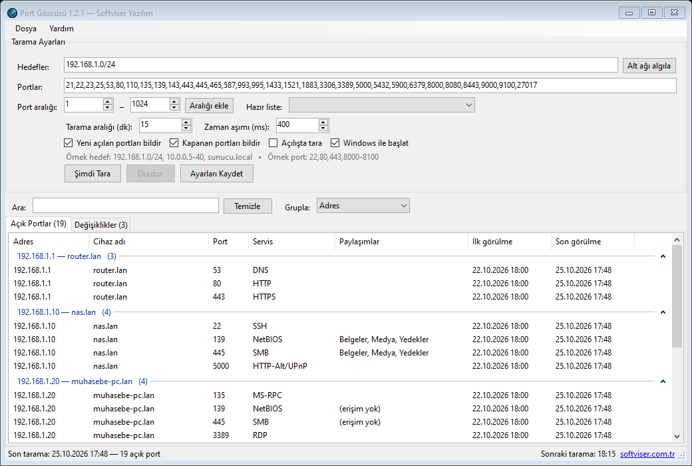
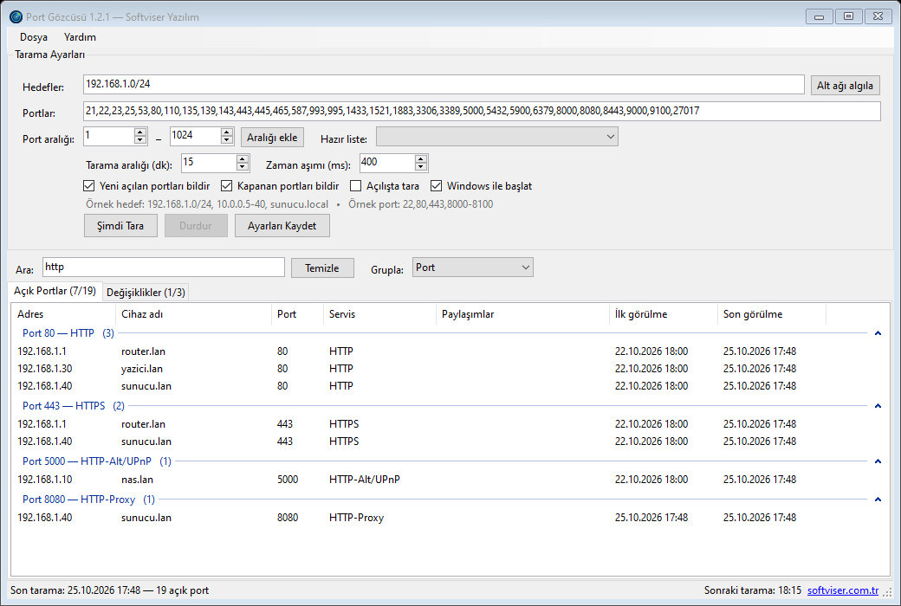
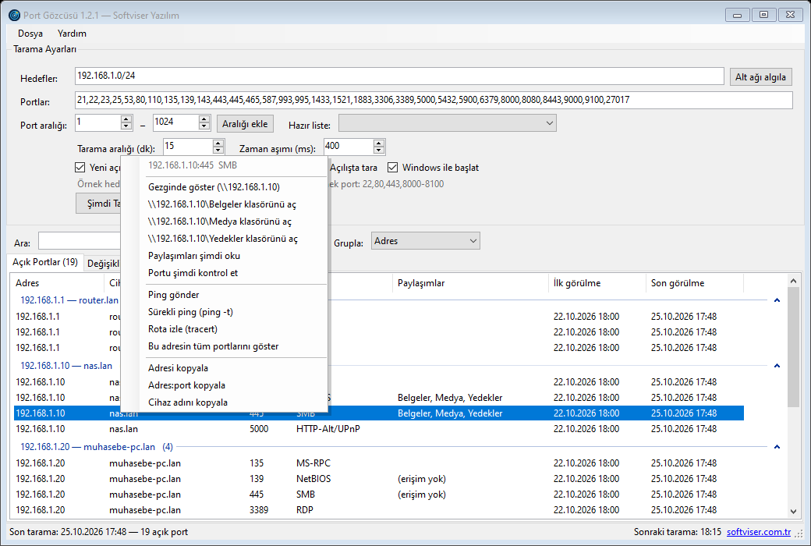
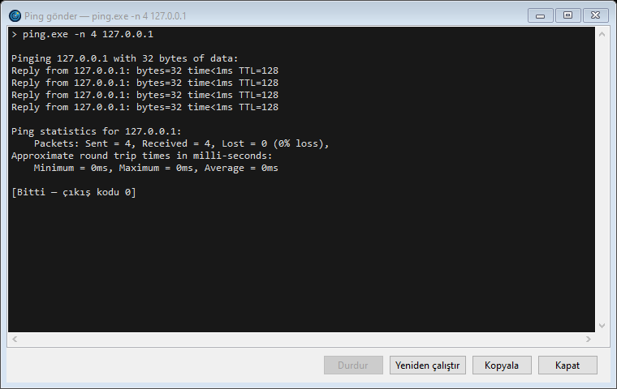

# Port Gözcüsü

Yerel ağdaki açık TCP portlarını belirli aralıklarla tarayan ve bir değişiklik olduğunda Windows bildirimi gösteren küçük bir sistem tepsisi uygulaması.

Ofis ya da ev ağında "dün kapalı olan bir port bugün neden açık?" sorusunu takip etmek için yazıldı. Yeni bir servis açıldığında, bir cihaz ağa katıldığında ya da çalışan bir servis durduğunda haberiniz olur.

Geliştirici: [Softviser Yazılım](https://softviser.com.tr) — MIT lisansı ile açık kaynak.



## Neler yapıyor

- Hedef girilmezse bağlı olunan yerel ağı (/24) kendisi bulur.
- Hedef olarak CIDR (`192.168.1.0/24`), aralık (`10.0.0.5-40` veya `10.0.0.5-10.0.1.20`), tek IP ya da makine adı kabul eder.
- Port listesi ve aralıkları: `22,80,443,8000-8100`. Varsayılan olarak sık kullanılan 30 kadar port taranır. Başlangıç–bitiş kutularıyla aralık eklenebilir ya da hazır listelerden (web, uzak erişim, veritabanı, dosya paylaşımı, 1-1024) biri seçilebilir.
- Sonuçlar adrese, porta ya da servise göre gruplanabilir; arama kutusu adres, cihaz adı, port, servis ve paylaşım adları üzerinde anında süzer. Sütun başlığına tıklayarak sıralanabilir (IP, port ve tarih sütunları değerine göre sıralanır).
- SMB (139/445) portu açık cihazlardaki paylaşılan klasörler okunur ve listede gösterilir; sağ tık menüsünden doğrudan açılabilir.
- Listede sağ tıklayınca porta uygun işlemler çıkar: RDP ile bağlan, SSH, Telnet, tarayıcıda aç (HTTP/HTTPS), paylaşılan klasörleri aç, VNC, PowerShell uzak oturumu. Her adres için ping, sürekli ping, tracert, portu yeniden kontrol etme ve kopyalama seçenekleri de vardır. Ping ve tracert ayrı bir komut penceresi açmadan uygulamanın kendi penceresinde çalışır.
- Yeni açılan ve kapanan portlar için bildirim gösterir, değişiklikleri `changes.log` dosyasına yazar.
- Cihaz adlarını (ters DNS / NetBIOS) ve bilinen servis adlarını (SSH, RDP, SMB, MySQL vb.) listeler.
- Açık port listesi CSV olarak dışa aktarılabilir.
- Pencere kapatıldığında tepside çalışmaya devam eder, istenirse Windows ile birlikte başlar.
- Yönetici yetkisi istemez. .NET kurulu olmasına gerek yoktur.

## Kurulum

[Releases](https://github.com/softviser/port-gozcusu/releases) sayfasında iki seçenek var:

- **`PortGozcusu-x.y.z-setup-win-x64.exe`** — normal kurulum. Başlat menüsüne ekler, Programlar ve Özellikler'den kaldırılabilir.
- **`PortGozcusu-x.y.z-portable-win-x64.zip`** — kurulum gerektirmez. Bir klasöre açıp `PortGozcusu.exe`'yi çalıştırmanız yeterli. Ayarlar ve geçmiş aynı klasördeki `data\` dizininde tutulur, USB bellekte de taşınabilir.

Yanlarında imza doğrulaması için `softviser-codesign.cer` ve `SHA256SUMS.txt` bulunur.

Windows 10 veya 11 (64 bit) gerekir.

## Kullanım

İlk açılışta yerel ağ otomatik olarak taranır. Bu ilk tarama referans kabul edilir, bildirim üretmez. Sonraki her taramada önceki sonuçla karşılaştırma yapılır ve fark varsa bildirim gelir.

Ayarlar ana pencerededir:

- **Hedefler:** Boş bırakırsanız yerel ağ kullanılır. "Alt ağı algıla" düğmesi bulunan ağı kutuya yazar, oradan düzenleyebilirsiniz.
- **Portlar:** Virgülle ayrılmış liste ya da aralık.
- **Tarama aralığı / zaman aşımı:** Varsayılanlar 15 dakika ve 400 ms. Yavaş Wi-Fi ağlarda zaman aşımını artırmak gerekebilir.

### Sonuçları gruplama ve arama

Listenin üstündeki **Grupla** kutusundan adres, port ya da servise göre gruplama seçilebilir; gruplar başlıklarına tıklanarak daraltılabilir. **Ara** kutusuna yazılan metin her iki sekmede de (açık portlar ve değişiklikler) uygulanır. Örneğin `http` yazıp porta göre gruplamak tüm web servislerini bir arada gösterir:



### Sağ tık menüsü

Bir satıra sağ tıkladığınızda o portun ne işe yaradığına göre işlemler listelenir. Örneğin 3389 için Uzak Masaüstü, 22 için SSH, 80/443/8080 için tarayıcı, 445 için paylaşılan klasörler açılır. Cihazda okunabilen paylaşımlar varsa her biri menüde ayrı ayrı yer alır.



Ping, sürekli ping ve tracert çıktısı uygulama içindeki bir pencerede canlı olarak akar. Komut buradan durdurulabilir, yeniden çalıştırılabilir ya da çıktı kopyalanabilir.



### Paylaşılan klasörler

Tarama sırasında 139 veya 445 portu açık olan cihazlardaki paylaşımlar okunur ve **Paylaşımlar** sütununda gösterilir. `C$`, `ADMIN$`, `IPC$` gibi yönetim paylaşımları listelenmez. Cihaz Windows kullanıcınızın erişimine izin vermiyorsa sütunda "(erişim yok)" yazar.

Paylaşımlar taramanın sonunda okunduğu için geniş port aralıklarında (ör. `1-1024`) sütun bir süre "(henüz okunmadı)" olarak kalabilir. Beklemek istemezseniz satıra sağ tıklayıp **Paylaşımları şimdi oku** seçeneğini kullanın. **Gezginde göster** cihazın tüm paylaşımlarını Windows Gezgini'nde açar.

Pencereyi kapattığınızda uygulama tepsiye iner. Tamamen kapatmak için tepsi simgesine sağ tıklayıp **Çıkış**'ı seçin.

Uygulama `--minimized` parametresiyle başlatılırsa pencere açılmadan doğrudan tepside çalışır (otomatik başlatma bunu kullanır).

Veriler şu klasörde tutulur:

- Kurulu sürüm: `%APPDATA%\Softviser\PortGozcusu\`
- Taşınabilir sürüm: `<exe'nin olduğu klasör>\data\` (exe'nin yanında `portable.txt` olduğu sürece)

**Not:** Yalnızca size ait ya da taramak için izniniz olan ağları tarayın.

## Dijital imza

Dağıtılan dosyalar Softviser Yazılım adına oluşturulmuş self-signed bir sertifika ile imzalanır. Ticari bir sertifika otoritesinden alınmadığı için Windows ilk çalıştırmada "Bilinmeyen yayımcı" ya da SmartScreen uyarısı gösterebilir.

İmzanın Softviser'a ait olduğunu bilgisayarınızda tanıtmak isterseniz, yönetici olarak açtığınız PowerShell'de:

```powershell
powershell -ExecutionPolicy Bypass -File .\trust-cert.ps1 -CerPath .\softviser-codesign.cer
```

Bunu yapmadan önce sertifikanın parmak izini sürüm notlarındaki değerle karşılaştırın. Geri almak için aynı komutu `-Remove` ile çalıştırabilirsiniz.

İmzayı kontrol etmek için dosyaya sağ tıklayıp **Özellikler > Dijital İmzalar** sekmesine bakabilir ya da şunu çalıştırabilirsiniz:

```powershell
Get-AuthenticodeSignature .\PortGozcusu.exe | Format-List
```

## Kaynaktan derleme

Gerekenler:

- [.NET 8 SDK](https://dotnet.microsoft.com/download)
- Kurulum dosyası da üretilecekse [Inno Setup 6](https://jrsoftware.org/isinfo.php) (`winget install JRSoftware.InnoSetup`)

```powershell
git clone https://github.com/softviser/port-gozcusu.git
cd port-gozcusu

# Geliştirme sırasında çalıştırmak için
dotnet run --project src\PortGozcusu

# Paketleri artifacts\ klasörüne üretir (imzasız)
.\build.ps1 -Version 1.0.0
```

İmzalı paket üretmek için önce bir kere sertifika oluşturun. `.pfx` dosyası `.gitignore`'da olduğu için depoya gitmez.

```powershell
.\scripts\new-selfsigned-cert.ps1

$env:PG_PFX_PASSWORD = '<pfx parolası>'
.\build.ps1 -Version 1.0.0 -Sign
```

`build.ps1` için diğer seçenekler:

| Parametre | Açıklama |
|---|---|
| `-NoTimestamp` | Zaman damgası sunucusuna bağlanmadan imzalar (internet yoksa). |
| `-NoInstaller` | Sadece taşınabilir ZIP üretir. |
| `-FrameworkDependent` | Daha küçük exe üretir, ancak hedef makinede .NET 8 Desktop Runtime gerekir. |

Birim testleri:

```powershell
dotnet test tests\PortGozcusu.Tests
```

### GitHub Actions

`.github/workflows/build.yml` her push'ta projeyi derler. `v1.0.0` gibi bir etiket gönderildiğinde GitHub Release oluşturur ve paketleri ekler.

Sürümlerin hep aynı sertifikayla imzalanması için depo ayarlarında iki secret tanımlanmalı:

- `CODESIGN_PFX_BASE64`: `[Convert]::ToBase64String([IO.File]::ReadAllBytes('certs\softviser-codesign.pfx'))` çıktısı
- `CODESIGN_PFX_PASSWORD`: PFX parolası

Bu secret'lar yoksa (örneğin bir fork'ta) her çalıştırmada geçici bir sertifika üretilir.

## Proje yapısı

```
src/PortGozcusu/
  MainForm.cs       Ana pencere, tepsi simgesi, gruplama/arama, sağ tık menüsü
  Scanner.cs        TCP tarayıcı, hedef/port ayrıştırma, yerel ağ tespiti
  PortActions.cs    Porta göre çalıştırılacak komutlar (RDP, SSH, tarayıcı, ping...)
  CommandOutputForm.cs  Ping/tracert çıktısını gösteren pencere
  Shares.cs         SMB paylaşımlarını okuma (NetShareEnum)
  ListSort.cs       Sütuna göre sıralama
  Models.cs         Ayarlar, tarama sonucu, değişiklik kaydı, servis adları
  AppInfo.cs        Sabitler, veri klasörü, otomatik başlatma
tests/              xUnit birim testleri
docs/               README görselleri
installer/          Inno Setup betiği
scripts/            Sertifika oluşturma, imzalama, sertifikayı güvenilir yapma
tools/              Uygulama simgesini üreten betik
build.ps1           Derleme ve paketleme
```

## Sürüm geçmişi

### 1.2.1

- Sağ tık menüsüne SMB portu açık cihazlar için **Gezginde göster** ve **Paylaşımları şimdi oku** eklendi.
- Paylaşımlar sütunu henüz okunmamış ya da boş olan cihazlarda "(henüz okunmadı)" / "(paylaşım yok)" yazıyor; önceden boş kalıyordu.
- Paylaşım işlemleri değişiklikler listesindeki satırlardan da kullanılabiliyor.

### 1.2.0

- Ping, sürekli ping ve tracert artık uygulama içindeki bir pencerede çalışıyor; ayrı komut satırı pencereleri açılmıyor. Çıktı durdurulabilir, yeniden çalıştırılabilir ve kopyalanabilir.
- SMB portu açık cihazlardaki paylaşılan klasörler listede gösteriliyor ve sağ tık menüsünden açılabiliyor.
- Açık portlar ve değişiklikler listelerinde sütun başlığına tıklayarak sıralama (artan/azalan).

### 1.1.0

- Sonuç listelerinde adrese, porta veya servise göre gruplama (seçim hatırlanır).
- Açık portlar ve değişiklikler listesinde arama/süzme.
- Port aralığı ekleme kutuları ve hazır port listeleri.
- Sağ tık menüsü: RDP, SSH, Telnet, tarayıcıda aç, paylaşılan klasörler, VNC, PowerShell uzak oturumu, ping, tracert, portu yeniden kontrol et, adres kopyalama.
- `10.0.0` gibi eksik yazılmış IP adresleri artık hata olarak bildiriliyor (önceden Windows bunu 10.0.0.0 olarak çözüyordu).
- Birim testleri ve CI'da test adımı eklendi.

### 1.0.0

- İlk sürüm: yerel ağ taraması, değişiklik bildirimi, tepside çalışma, taşınabilir ve kurulabilir paketler, self-signed imza.

## Katkı

Hata bildirimleri ve öneriler için [issue](https://github.com/softviser/port-gozcusu/issues) açabilirsiniz. Pull request'ler de memnuniyetle karşılanır.

## Lisans

MIT. Ayrıntılar için [LICENSE](LICENSE) dosyasına bakın.

Copyright (c) 2026 [Softviser Yazılım](https://softviser.com.tr)
